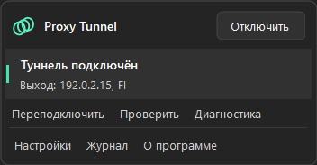
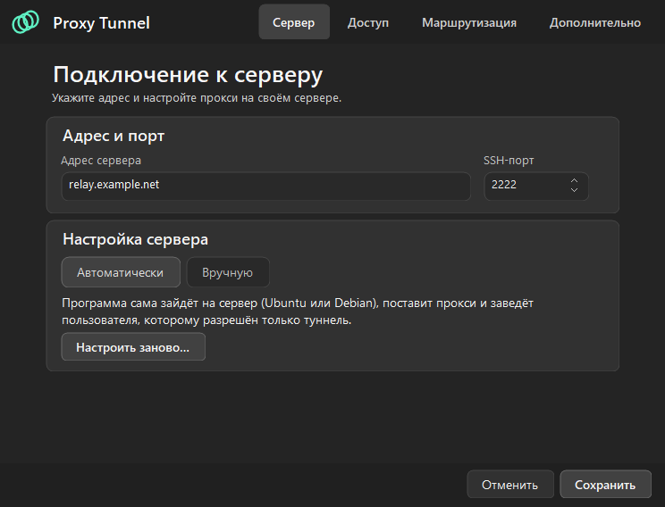
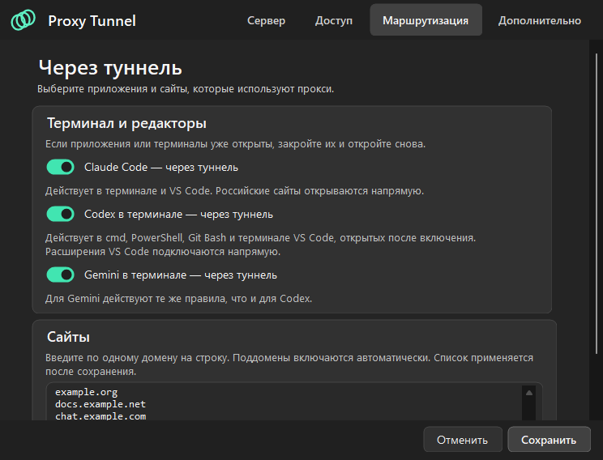

# Proxy Tunnel

Выберите, какие приложения и сайты подключать через ваш SSH-сервер. Proxy Tunnel живёт у часов, показывает IP выхода и позволяет включать и выключать туннель одним нажатием.

**[Скачать для Windows x64](https://github.com/lyfreedomitsme/proxy-tunnel-ai/releases/latest/download/ProxyTunnel-windows.exe)** · **[Скачать для macOS](https://github.com/lyfreedomitsme/proxy-tunnel-ai/releases/latest/download/ProxyTunnel-mac.dmg)** · [Все выпуски](https://github.com/lyfreedomitsme/proxy-tunnel-ai/releases)

[Короткое видео о Windows-версии](https://github.com/lyfreedomitsme/proxy-tunnel-ai/releases/download/v1.4.0/ProxyTunnel-1.4-Demo.mp4)

## Подключение

Понадобятся Windows 10/11 или macOS 13+, SSH-доступ к своему серверу и выход в интернет за пределами РФ. Автоматическая установка прокси поддерживает Ubuntu и Debian.

1. **Откройте приложение.** В Windows запустите скачанный EXE. На Mac откройте DMG и перетащите Proxy Tunnel в «Программы». Если macOS запросит подтверждение, откройте приложение через контекстное меню или раздел «Конфиденциальность и безопасность».
2. **Укажите сервер.** Введите адрес и SSH-порт. Для каскада указывайте точку входа. Например, можно подключиться к `relay.example.net:2222`, а в панели увидеть другой адрес выхода.
3. **Нажмите «Настроить сервер».** Программа проверит вход по ключу. Если нужен пароль, введите его в окне приложения. Для ручной установки есть режим «Вручную».
4. **Откройте панель у часов.** В Windows нажмите «Подключить», на Mac — карточку состояния. После подключения заново откройте приложения и терминалы, которые уже были запущены.

## Маршрутизация

В Windows откройте вкладку «Маршрутизация», на Mac — раздел «Через туннель». Для Claude Code, Codex CLI и Gemini CLI есть отдельные переключатели. В Windows зелёный цвет означает, что маршрут включён. Изменения для команд терминала действуют в новых окнах.

Для браузера и приложения Claude добавьте нужные домены в список «Сайты» и нажмите «Сохранить». Каждый домен занимает одну строку и включает поддомены. Список используют приложения, которые учитывают системные настройки прокси. На macOS также можно отдельно подключить расширение Codex или весь VS Code.

## Как проверить соединение

В Windows зелёная галочка у часов означает, что проверки прошли. Серый значок питания означает, что туннель выключен. При ошибке в панели появится причина. Нажмите «Диагностика», чтобы увидеть результаты по отдельности, или «Журнал», чтобы открыть записи приложения.

Кнопка «Проверить» отправляет запрос к `claude.ai/cdn-cgi/trace` через локальный прокси. Панель показывает публичный IP и страну, которые сайт видит на выходе. Поэтому каскад с разными адресами входа и выхода тоже проходит проверку. Адреса и состояние соединения на скриншотах демонстрационные.

## Помощь и конфиденциальность

- [Пошаговая настройка](AI-SETUP.md) — инструкцию можно передать своему ИИ-помощнику. Попросите вести вас по одному шагу. Пароль вводите только в приложении.
- [Устройство и сборка](TECHNICAL.md) — схема туннеля, системные настройки, диагностика и сборка обеих версий.
- Приложение не отправляет статистику использования. Обновления доступны в выпусках GitHub. На macOS имя SSH-сервера может передаваться DNS-резолверам Cloudflare и Google при подключении по доменному имени.

Основано на Proxy Tunnel лаборатории [Life OS](https://lifeos.antonlozhkin.ru/). [Исходный проект и его история](https://antonlozhkin.ru/cases/proxy-tunnel/).
